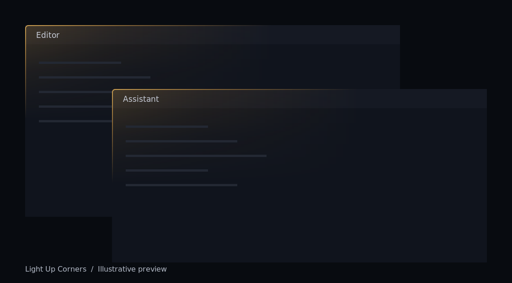

# Light Up Corners · 点亮角落

A GNOME Shell extension that adds a soft dark-gold glow to the upper-left corner of VS Code and ChatGPT windows, making overlapping dark windows easier to distinguish.

[中文安装说明](README.zh-CN.md)



*Illustration generated with the extension renderer; not a desktop screenshot.*

## v0.1.0 compatibility

Tested on GNOME Shell 42.9 with X11. The package declares support for GNOME 42 only. Other GNOME versions, Wayland, fractional scaling, and different application distributions have not been verified. Ubuntu alone does not establish compatibility: check `gnome-shell --version` and `echo "$XDG_SESSION_TYPE"` first.

## Appearance

- Continuous dark-gold top edge, rounded corner, and left edge.
- Horizontal length: 21.09375% of the window's monitor width (540 px on a 2560 px wide monitor).
- Vertical length: horizontal length × ((√5 − 1) / 2)², approximately 38.1966% (206 px at the default size).
- Active windows are brighter; fullscreen windows have no decoration.
- The glow follows window stacking and does not accept pointer input.
- Only X11 window classes `code` and `Chatgpt` are matched. Browser tabs and other app variants are not included.
- No network access, telemetry, clipboard access, or application-content inspection.

## Install

Download the `.shell-extension.zip` release asset and run in its directory:

```sh
gnome-extensions install ./light-up-corners@shuyu.shell-extension.zip
```

On the tested X11 session, press **Alt+F2**, type **r**, and press **Enter** to reload GNOME Shell. Then enable the extension:

```sh
gnome-extensions enable light-up-corners@shuyu
gnome-extensions info light-up-corners@shuyu
```

For a later update, add `--force` to the install command, then reload Shell again. Disabling and enabling alone does not reload changed JavaScript.

If the earlier development extension `dark-gold-corners@qcraft.local` is installed, disable it before enabling this package to avoid drawing the glow twice:

```sh
gnome-extensions disable dark-gold-corners@qcraft.local
```

## Disable or uninstall

```sh
gnome-extensions disable light-up-corners@shuyu
gnome-extensions uninstall light-up-corners@shuyu
```

## Build

From this source directory:

```sh
mkdir -p dist
gnome-extensions pack . --extra-source=LICENSE --out-dir=dist
```

The ZIP contains readable JavaScript, metadata, and the license. It needs no Node.js or third-party package at runtime.

## Validation and development

The appearance was accepted on the original GNOME 42.9 / X11 setup. Syntax, Cairo rendering, simulated monitor-size updates, window-size clipping, and signal cleanup were checked. Cross-machine installation and live resolution changes remain to be verified by testers. This release preserves the accepted drawing and window-management code.

Change `HORIZONTAL_MONITOR_RATIO` in `extension.js` to adjust horizontal length. Vertical length follows automatically. Reload Shell after code changes.

This project was developed with AI assistance. Maintainers and contributors should review and understand the implementation before distributing changes.

## License

MIT. This is an independent project, not an official VS Code or ChatGPT extension.
